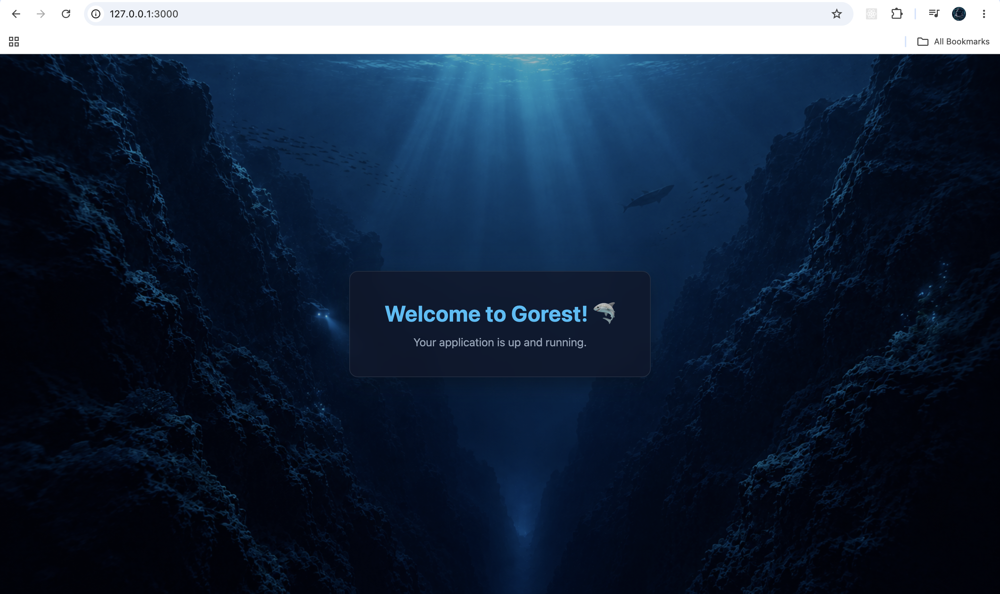

# GOREST

GOREST is an opinionated Go framework for building websites, REST APIs, and
backend services. It brings common application lifecycle, HTTP, logging,
database, and optional Redis infrastructure together so Go teams can reduce
repetitive setup while keeping handlers and business rules in regular Go code.

GOREST is for developers who want useful conventions and integrated tools
without giving up direct access to Go packages or database-specific APIs. For
the component map and lifecycle, see the [architecture overview](docs/architecture.md).


---

## ⚙️ Requirements

GOREST requires **Go 1.26.5** or higher.

Additional requirements depend on the components used by your application.

If you need to install or upgrade Go, visit the [official Go download page](https://go.dev/dl/).

### Supported Databases
GOREST provides database adapters for:
- Oracle
- SQL Server
- PostgreSQL
- MySQL
- SQLite
- MongoDB
- ScyllaDB

---

## 💡 Why GOREST?

Go gives developers a simple language, strong performance, and the freedom to choose their own tools. However, building maintainable backend applications also requires consistent conventions for application structure, configuration, logging, data access, and lifecycle management.

GOREST provides an opinionated foundation for these recurring concerns, helping teams reduce repetitive infrastructure work and keep applications consistent as they grow.

GOREST provides ORM and native database APIs for seven drivers. Its unit and
integration tests cover database operations, parameter binding, HTTP CRUD, and
selected concurrency scenarios. The [ORM guide](docs/guide/orm.md),
[querying guide](docs/guide/querying.md), and
[integration test guide](integration_test/README.md) describe their scope,
driver-specific limitations, and how to run the checks.
Transaction, connection, migration, and query behavior varies by database
engine; check the [driver feature matrix](docs/guide/orm.md#7-driver-feature-matrix)
and run the [integration tests](integration_test/README.md) for the database
and version you plan to use. For a quick evaluation, follow the
[manual CRUD tutorial](docs/guide/orm-tutorial.md#2-run-one-manual-crud-flow)
or run the [automated integration suite](integration_test/README.md) against
your database.

**Security:** GOREST configures HTTP middleware for CORS, panic recovery,
request IDs, compression, security headers, and rate limiting. These are
building blocks, not a complete security policy or an independent security
audit. Applications must define caller authentication and resource-level
authorization. Teams must also review middleware settings and configure
transport security, trusted network boundaries, and secrets for their
deployment. Database and Redis TLS support varies by driver and must be
verified in the target environment. The
[OWASP ASVS mapping](docs/security/asvs-matrix.md) records the framework's
current scope, evidence, and application/deployment responsibilities. See the
[server configuration guide](docs/configuration.md#2-http-server-configuration-serverrun).

**Production use:** GOREST provides reusable database, ORM, native query,
Redis, filter, logger, and operational features. Configure and validate them
for your own database versions, security policies, application behavior, and
deployment topology. See the [features and deployment guide](docs/production-validation.md)
for an overview and [database and framework guides](docs/testing-result.md)
for configuration details. GOREST does not include a built-in file upload or
background job queue subsystem.

### What GOREST Provides

- **Consistent Application Structure** — Establishes predictable conventions that make projects easier to navigate, maintain, and hand over between developers.
- **Integrated Infrastructure** — Brings together application lifecycle management, HTTP server integration, configuration, structured logging, optional Redis, and database connectivity.
- **Flexible Data Access** — Supports both native database APIs and ORM, allowing developers to choose the appropriate abstraction for each use case.
- **Explicit and Predictable Behavior** — Validates important configuration and query constraints where applicable, helping detect problems early instead of silently guessing developer intent.
- **Developer Control** — Keeps application and business logic in regular Go code. Developers can still use the standard library and other packages whenever GOREST's abstractions are not suitable.

GOREST provides a foundation, not a replacement for Go. Its purpose is to
reduce repetitive infrastructure work while leaving implementation decisions
and business requirements under the developer's control.
For configuration and implementation details, use the
[documentation guide](#documentation).

---

### Focus on Business Logic

GOREST handles common application infrastructure so developers can spend more
time implementing application-specific requirements. Depending on the
application, it provides:

- HTTP server and routing integration
- Centralized application bootstrapping and lifecycle management
- Configuration and structured logging
- Optional Redis integration for Redis-backed operations
- Database connection management
- Database migrations and seeders
- Native SQL and ORM-based data access
- REST API response helpers
- Optional JWT token and request-filter helpers

The application remains regular Go code. Developers can use Go's standard
library and other packages when a requirement falls outside GOREST's
abstractions.
See the [server and router guide](docs/guide/router.md),
[configuration guide](docs/configuration.md), and
[logger guide](docs/guide/logger.md) for the corresponding technical details.
The [architecture overview](docs/architecture.md) explains how these
components fit into application startup and request handling.

---

## 🛠️ What GOREST Provides

### Opinionated Application Structure

GOREST provides consistent conventions for organizing backend applications.
A predictable structure can help teams onboard developers, navigate projects,
and transfer knowledge without enforcing every implementation detail.

### Fail-Fast Configuration

GOREST validates important application and database configuration during
initialization and validates query-related constraints where applicable. The
goal is to detect invalid state early rather than let it propagate further
into application execution.

### Native SQL and ORM

GOREST supports both native database APIs and ORM-based data access.

Use native APIs when you need:

- Direct control over queries
- Database-specific capabilities or complex queries
- Predictable query behavior with minimal abstraction

Use the ORM when you need:

- Structured model mapping and query building
- Relationships and preloading
- Filtering, ordering, and pagination
- Parameter binding and common CRUD operations

Choose the appropriate approach per operation; an application does not need
to use one abstraction for every query. See the [querying guide](docs/guide/querying.md)
for a comparison and the [ORM tutorial](docs/guide/orm-tutorial.md) for a
worked example, or use the [ORM reference](docs/guide/orm.md) to look up
specific operations and driver support.

### Integrated Application Lifecycle

GOREST provides a centralized lifecycle for initializing registered
infrastructure and starting the application:

```text
Configuration
    ↓
Logging
    ↓
Registered Database / Redis
    ↓
HTTP Server
    ↓
Application
```

Only registered and enabled optional components are initialized. When database
startup tasks are enabled, GOREST runs them before making the HTTP listener
available. Startup failures abort startup. If a migration or seeder fails,
GOREST attempts bounded rollback using SQL transactions where supported and
matching `.down` compensation files. Rollback is best-effort because some
drivers may implicitly commit schema changes or become unreachable. See the
[migration and seeder guide](docs/guide.md#migration-seeder) for recovery
behavior and limits.
For application setup and subsystem defaults, see the
[configuration guide](docs/configuration.md).

---

## 🛠️ Features

### 1. Application Lifecycle & Initialization

- **Centralized Bootstrapping** — Coordinates application initialization and startup.
- **Thread-Safe Initialization** — Protects critical initialization paths from concurrent execution.
- **Startup Timeout** — Uses a startup context timeout to prevent initialization from waiting indefinitely on slow external dependencies.
- **Database Timezone Configuration** — Passes the configured timezone to database drivers that support it without changing Go's process-wide timezone.

### 2. Integrated Infrastructure

- **HTTP Server & Routing** — Integrates the HTTP server and route registration into the application lifecycle.
- **Structured Logging** — Provides a common logging foundation for framework lifecycle messages and application use through the logger API.
- **Redis Integration** — Supports optional Redis connectivity for caching and other Redis-backed operations.
- **Multi-Database Support** — Provides modular adapters for Oracle, SQL Server, PostgreSQL, MySQL, SQLite, MongoDB, and ScyllaDB.

### 3. Database Migrations & Seeders

- **Database Migrations** — Supports controlled schema migration workflows.
- **Database Seeders** — Supports inserting initial or development data through application-managed seeders.
- **Driver-Specific Migrations** — Accommodates the capabilities and requirements of individual database drivers.

For production, run migrations and seeders once through a dedicated deployment
job before starting application replicas. See the
[migration and seeder guide](docs/guide.md#migration-seeder) for execution,
coordination, and recovery details.

### 4. Data Access & ORM

- **Native SQL and Driver APIs** — Allows direct query execution and database-specific behavior.
- **Query Builder & ORM** — Supports model mapping, query construction, filtering, ordering, pagination, and parameter binding.
- **Relationship Preloading** — Supports configured relationships and preloading.
- **Explicit Relationship Configuration** — Validates relationship metadata where applicable instead of relying on silent inference.
- **Pluralization Support** — Handles common and irregular pluralization rules when mapping models to tables.
- **Exact Column Matching** — Validates selected columns and aliases through exact matching.
- **SQL-Aware Parameter Parsing** — Accounts for SQL string literals, comments, and PostgreSQL dollar-quoted sections when parsing placeholders.
- **Strict Parameter Binding** — Validates placeholder and argument alignment before query execution.

<a id="quick-start"></a>

## ⚙️ Installation & Getting Started

To get started with **Gorest**, follow these simple steps to set up your local development environment.

### 1. Create new project
```bash
mkdir myapp
```

```bash
cd myapp
```

```bash
go mod init myapp
```

```bash
go get github.com/elsyahtech/gorest
```

---

### 2. Create `main.go`

The simplest way to start a GOREST application is to use its built-in defaults. You do not need to register the logger or HTTP server manually.

```go
package main

import "github.com/elsyahtech/gorest"

func main() {
    app := gorest.New()
    app.Start()
}
```

### 3. Run the application

```bash
go run main.go
```

Open `http://127.0.0.1:3000` in your browser.



GOREST initializes the logger and HTTP server with their default configurations. The basic example does not register or connect to a database. SQLite is the default driver when you register the database subsystem, so it can be used without a separate database server.

**This quick start uses defaults.** You only need to configure individual subsystems when your application requires different settings.

---

### Looking for a Complete Application Using Gorest?
The minimal setup above is all you need to get GOREST running. If you want to explore a more complete application with practical implementation examples, check out the official starter project:

👉 **[GOREST API Starter](https://github.com/elsyahtech/gorest-api-starter)**

The starter provides practical examples of CRUD operations, database transactions, migrations, and native database queries to help you understand how to build an application with GOREST.

---

## 🔧 Customize When You Need To

When you need to customize application settings, you can pass a configuration object to gorest.New(...). This keeps configuration explicit and accessible in your Go code.

---

### 1. Application Core Configuration (gorest.Config)
```go
app := gorest.New(gorest.Config{
    // Application name used in framework metadata and logs.
    AppName: "My App",

    // Application version metadata.
    Version: "1.0.0",

    // Operating environment mode (e.g., "development", "staging", "production").
    Environment: "development",

    // Timezone used by database drivers that support application timezone configuration.
    Timezone: "Asia/Jakarta",

    // Debug mode. When true, the HTTP server listener is not started.
    Debug: false,

    // Explicit application-wide opt-in for intentional non-TLS database or Redis
    // connections in production-like environments. Prefer TLS in production.
    AllowInsecureProduction: false,

    // Disable built-in operational endpoints when they should not be exposed.
    // Monitoring endpoints are enabled by default.
    DisableMonitoringEndpoints: false,
})
```

- **AppName:** Identifies the application in framework metadata and logs.
- **Version:** Stores the application version as metadata; connect it to release tooling as needed.
- **Environment:** Controls runtime behaviors (development, staging, production).
- **Timezone:** Configures the timezone for database drivers that support it (currently MySQL and Oracle). It does not change Go's process-wide `time.Local`; configure timezone handling explicitly in application code for logs, token expiration, and other values.
- **Debug:** When set to true, prevents the HTTP server listener from starting. It does not itself make migrations or seeders a dry run.
- **AllowInsecureProduction:** Application-wide explicit opt-in for intentional non-TLS database or Redis connections in production-like environments. It does not waive TLS when TLS is available; configure the backend securely by default and use this only for trusted, documented exceptions. Foreground startup may prompt interactively, while headless startup requires this typed opt-in or the corresponding component opt-in.
- **DisableMonitoringEndpoints:** When `true`, prevents GOREST from registering its built-in monitoring routes. The default is `false`, so `/gorest/live`, `/gorest/ready`, `/gorest/metrics`, and `/gorest/storage` are enabled unless explicitly disabled. See the [operational endpoints guide](./docs/configuration.md#operational-endpoints-and-environment-configuration) for endpoint behavior and privacy considerations.

---

### 2. Custom Subsystem Configuration (`app.Use`)

Use `app.Use(...)` when you need to register or customize subsystem configurations. It accepts supported configuration values or pointers, including `log.Config`, `database.Config`, `redis.Config`, and `server.Config`, `filter.Config`.

The logger and HTTP server are already initialized by `gorest.New()`. Register them again only when you want to apply explicit subsystem configurations.

#### Configure the database

The following example explicitly registers the default database configuration. SQLite remains the selected driver unless you change it.

```go
package main

import (
    "github.com/elsyahtech/gorest"
    "github.com/elsyahtech/gorest/database"
)

func main() {
    app := gorest.New()

    dbConfig := database.ConfigDefault
    dbConfig.Driver = database.SQLITE

    app.Use(database.Run(dbConfig))

    app.Start()
}
```

`database.Run(config)` applies database configuration defaults and returns the normalized configuration. It does not establish the database connection by itself; `app.Use(...)` registers the returned configuration with the application.

The database `Disable` field defaults to `false`, so `app.Use(...)` initializes it unless you set `Disable: true`. A partial `database.Config` literal also has `Disable: false` by Go's zero-value rule; use `database.ConfigDefault` when you want the other configured defaults.

#### Configure Redis only when needed

Redis is optional. Its `Disable` field defaults to `false`, so `app.Use(...)` initializes it unless you set `Disable: true`. Ensure the Redis service is reachable.

```go
redisConfig := redis.ConfigDefault

app.Use(redis.Run(redisConfig))
```

Add the `github.com/elsyahtech/gorest/redis` import to use this example. Configure the host, credentials, and TLS settings as required by your environment.

#### Customize logging or the HTTP server

You can pass explicit configurations when you need to change their settings:

```go
app.Use(
    log.Run(log.ConfigDefault),
    server.Run(server.ConfigDefault),
)
```

This example reapplies the default logger and server settings; it is not required for a basic application. To customize them, modify the corresponding configuration values before passing them to `app.Use(...)`.

For configuration fields, environment-specific settings, database drivers, migrations, and seeders, see the [Configuration Guide](./docs/configuration.md).

---

## 📚 Documentation

### Find the right guide

Start with the task you want to complete. For the full map, including all
technical references, see the [documentation index](./docs/README.md).

#### Start and configure

- [Install GOREST and run the quick start](#quick-start)
- [Configure logging, HTTP, Redis, or a database](./docs/configuration.md)
- [Understand the application architecture and lifecycle](./docs/architecture.md)
- [Register routes and configure middleware](./docs/guide/router.md)

#### Build application features

- [Choose ORM or native database APIs](./docs/guide/querying.md)
- [Follow a working ORM CRUD example](./docs/guide/orm-tutorial.md)
- [Look up ORM operations and driver support](./docs/guide/orm.md)
- [Set up JWT filter behavior](./docs/guide/filter.md)
- [Parse request bodies and use helper functions](./docs/guide/helpers.md)
- [Handle JSON responses](./docs/guide/response/view_response.md)

#### Operate, diagnose, and validate

- [Configure and try built-in liveness, readiness, metrics, and storage endpoints](./docs/configuration.md#operational-endpoints-and-environment-configuration)
- [Run migrations and seeders or recover failures](./docs/guide.md#migration-seeder)
- [Diagnose a problem](./docs/troubleshoot.md)
- [Review security scope and responsibilities](./docs/security/asvs-matrix.md)
- [Configure GOREST features for your environment](./docs/production-validation.md)
- [Run framework integration tests](./integration_test/README.md)

#### Reference and community

- [Browse the Go API reference](./docs/api-reference.md)
- [Check versions and review changes](./docs/versioning.md)
- [Browse the release changelog](./CHANGELOG.md)
- [Get help or report an issue](./docs/support.md)
- [Contribute to GOREST](./CONTRIBUTING.md)

GOREST supplies reusable application infrastructure; handlers, business rules,
authentication, authorization, and deployment policy remain application
responsibilities. Use standard Go packages whenever the framework is not the
right fit.

The [GOREST guide](./docs/guide.md) covers lifecycle behavior, migration and
seeder workflows, entity mapping, and response handling. Database and
framework usage guidance is indexed in
[GOREST database and framework guides](./docs/testing-result.md).

## 🔧 Troubleshooting
For common setup, request, database, Redis, and migration problems, see the
[Troubleshooting Guide](./docs/troubleshoot.md).

## 🎧 Support

Before requesting help, review the [documentation index](./docs/README.md)
and [troubleshooting guide](./docs/troubleshoot.md). Use
[GitHub Issues](https://github.com/elsyahtech/gorest/issues) for a reproducible
bug, feature request, or technical question. Include relevant version and
environment details, a minimal reproduction, and sanitized logs; never post
credentials or private data. For suspected vulnerabilities, use the private
process in [SECURITY.md](./SECURITY.md), not a public issue. GOREST is
open-source and does not provide a general support SLA or guaranteed response
time. See the [support guide](./docs/support.md) for details.

### Contributing
Read the [contribution guidelines](./CONTRIBUTING.md) before proposing a
change. Contributions are reviewed against project needs and quality
requirements; submitting a pull request does not guarantee acceptance.
