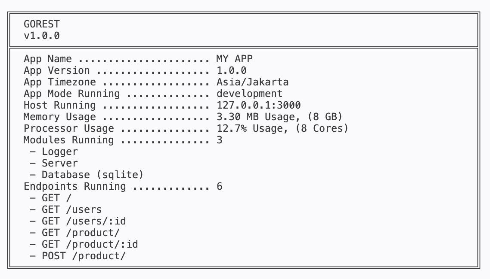

## 1. Logger Guide
Gorest integrated with Zap as a core logger.

* **Overview:** A high-performance, built-in structured logger for GOREST lifecycle and framework messages.
* **Key Benefits:** Zap-based structured logging, automatic size-based file rotation with backup count and age limits, and heuristic redaction of recognized sensitive values. Applications remain responsible for emitting their own request/business events, minimizing logged data, and redacting application-specific sensitive values before logging.
* **Sample Output Preview:**
```text
{"level":"info","timestamp":"2026-10-06T22:44:31.036+0700","message":"starting gorest","service":"My App"}
{"level":"info","timestamp":"2026-10-06T22:44:31.036+0700","message":"starting server","service":"My App"}
{"level":"info","timestamp":"2026-10-06T22:44:31.138+0700","message":"Endpoints running ['GET /', 'GET /users', 'GET /users/:id', 'GET /product/', 'GET /product/:id', 'POST /product/']","service":"My App"}
{"level":"info","timestamp":"2026-10-06T22:44:31.138+0700","message":"server started successfully","service":"My App"}
{"level":"info","timestamp":"2026-10-06T22:44:31.138+0700","message":"gorest is running","service":"My App"}
```
Read the full logger technical breakdown: [Logger Technical Guide](./guide/logger.md)

---

## 2. Server & Router Guide

* **Overview:** Built on Fiber, GOREST provides HTTP routing, middleware configuration, and server lifecycle integration.
* **Key Benefits:** Fast request handling, clean modular route grouping, and configurable HTTP middleware for CORS, panic recovery, request IDs, response compression, security headers, and rate limiting. These are infrastructure controls; applications still define authentication, authorization, and endpoint-specific access rules.
* **Sample Output Preview:**



Read the full Server & Router technical breakdown: [Router Technical Guide](./guide/router.md)

---

## 3. Database, ORM & Querying Guide
* **Overview:** A multi-driver data persistence layer with driver-specific migration and seeder workflows, execution history, and a reflection-powered ORM.
* **Key Benefits:** Supports 7 database drivers (MySQL, PostgreSQL, SQL Server, Oracle, SQLite, MongoDB, ScyllaDB) with ORM features such as custom `gorest` tags and `Preload()`, plus native query APIs. The best fit depends on the operation; the Querying Guide compares their tradeoffs and explains when each may be appropriate.
* **Sample Output Preview:**

Start with the [Querying Guide](./guide/querying.md) to compare ORM and native queries, then use the [ORM Tutorial](./guide/orm-tutorial.md) for a guided ORM path. The [Database Guide](./guide/database.md) covers connection and schema setup; the [ORM Guide](./guide/orm.md) is the ORM feature reference.

---

## 4. Database Migration & Seeder

### How to Run Migration:

By default, migrations and seeders can be triggered automatically upon application startup by simply setting `Migration: true` and `Seeder: true` inside your database configuration block in `main.go`:
```go
dbConfig := database.ConfigDefault
dbConfig.Driver = database.SQLITE
dbConfig.Name = "default_gorest"
dbConfig.Migration = true // Set to true to auto-run migrations on boot
dbConfig.Seeder = true    // Set to true to auto-run seeders on boot

app.Use(database.Run(dbConfig))
```

`database.Run(...)` normalizes and returns the database config; it does not connect to the database by itself. `app.Use(...)` receives that normalized config and initializes the connection. The `Disable` field defaults to `false`, so registration initializes the database unless you explicitly set `Disable: true`. A partial config literal also has `Disable: false` by Go's zero-value rule; start from `database.ConfigDefault` if you want the other configured defaults.

For a dedicated deployment job that runs configured migrations and seeders without starting HTTP, call `app.RunDatabaseStartupTasks()` after `app.Use(...)`, then close the app. Run this job once before starting or updating application replicas. Keep `Migration` and `Seeder` disabled in the replicas themselves.

```go
app := gorest.New(gorest.Config{AppName: "database setup"})
app.Use(database.Run(dbConfig))

if err := app.RunDatabaseStartupTasks(); err != nil {
	_, _, _ = app.Close()
	log.Fatal(err)
}
if message, _, err := app.Close(); err != nil {
	log.Fatalf("cleanup failed: %s: %v", message, err)
}
```

### Startup behavior when migration or seeding fails

When enabled, Gorest runs database startup tasks synchronously before starting the HTTP server. Migration runs before seeding when both are enabled. The `Migration` and `Seeder` flags are independent, so seeding can be enabled without running migrations.

If a migration or seeder returns an error, Gorest logs the failure and aborts application startup; the application is not started. If migration fails, seeding is skipped. Check the logged error and message, resolve the database or script issue, then restart the application. A failed task may already have made database changes; rollback behavior depends on the database driver and migration script.

When `app.Start()` receives `SIGINT` or `SIGTERM`, GOREST initiates graceful Fiber shutdown and waits for active requests to finish before closing Redis, database, and logger resources. The graceful wait is bounded by 30 seconds; if it expires, shutdown reports an error and proceeds with closing the remaining services. Calling `app.Close()` directly follows the same server-before-dependencies order. Applications do not need to reach into GOREST's server or service instances to perform this shutdown sequence.

> **Migration and seeder coordination:** GOREST uses a database-backed `gorest_migration_lock` record to prevent two current-version GOREST startup runners from executing migrations or seeders concurrently. The lock is intentionally not time-limited. A failed run or unclean shutdown leaves the lock in place, and the `gorest_migration_state` store records each file's content hash and `running`/`applied` status. GOREST blocks a retry when it finds a failed or unfinished state. For recovery, stop all runners, inspect the affected schema/data, the `gorest_migration_state` entry (`migration:<filename>` or `seeder:<filename>`), and the existing execution history. Reconcile the state based on what actually completed, then manually remove the `database_startup` lock record using the database's native tools. Do not delete state or lock records before inspecting the database. Older GOREST versions do not use this lock and must not run migrations at the same time.
>
> **Migration and seeder history:** The existing history store records filenames; GOREST does not infer that a file is safe to skip because a table or collection exists. Applied files are immutable: add a new file instead of editing one. For files recorded by older GOREST versions, the first upgraded run backfills a hash from the file currently present; edits made before that upgrade cannot be detected. The lock and state records prevent concurrent execution and automatic retry after a failure, but do not make schema changes atomic. A script may have changed the database before failing, and rollback behavior depends on the driver and script. Test against an isolated staging database, take appropriate backups, and use backward-compatible expand-and-contract changes when application versions overlap during deployment.

### Integration coverage

The managed HTTP integration runner for each of the seven drivers creates a temporary migration file and seeder file using that driver's supported format, calls `app.RunDatabaseStartupTasks()`, verifies the seeded data, and calls the startup tasks a second time to check successful repeat-run behavior. It also starts two independent OS processes against a two-file migration fixture: the first pauses after file one is applied and file two is recorded as `running`; the second must be rejected by the database startup lock. A separate run kills a real child process at that pause point, verifies the applied/running history and retained lock, confirms a new startup is rejected, then performs operator recovery and reruns successfully. For the six container-backed drivers, another scenario force-stops the database container with zero-second stop grace while the migration process holds the lock between files, restarts that same container, checks the persisted state and lock, and verifies recovery and rerun. PostgreSQL, MySQL, and SQL Server additionally run a deliberately slow migration statement; the test checks the database activity view to confirm it is active before killing the migration process, then verifies unfinished state and recovery. Oracle, MongoDB, and ScyllaDB currently have restart coverage at a migration-file boundary, not an in-flight statement interruption test. SQLite has no separate database server, so its process recovery scenario is used instead. The synchronization hooks exist only in builds using the `integration` build tag. These tests do not simulate host power loss or storage corruption, or make a multi-file migration batch atomic. Run the matching `make integration-test-<driver>-e2e` target described in the [integration test guide](../integration_test/README.md#managed-http-end-to-end-runners); account for those limits and deployment considerations separately.

---

### Create Migration File:

Create a new directory in your project root with the structure shown below. You can adjust it based on the database driver you choose.

```text
./database/
├── migrations/
│   ├── mongo/
│   ├── mysql/
│   ├── oracle/
│   ├── postgres/
│   ├── scylla/
│   ├── sqlite/
│   └── sqlserver/
└── seeders/
    ├── mongo/
    ├── mysql/
    ├── oracle/
    ├── postgres/
    ├── scylla/
    ├── sqlite/
    └── sqlserver/
```

Create .sql, .cql, or .json files according to your chosen database driver inside each of those respective directories.

Read Schema Sample for migration and seeder needs [SQL Schema](./guide/database/schema.md)

---

## 5. Defining Entities & Struct

Gorest uses the `gorest` struct tag to map Go fields to database columns or document fields. The first item is the database field name; comma-separated items after it are options. The `json` tag is separate and controls JSON input/output names.

```go
type User struct {
	ID           string      `gorest:"id, primary_key, required" json:"id"`
	Email        string      `gorest:"email, required, unique" json:"email"`
	Password     string      `gorest:"password, required" json:"password"`
	DepartmentID string      `gorest:"department_id, required" json:"departmentId"`
	IsActive     bool        `gorest:"is_active" json:"isActive"`
	CreatedAt    time.Time   `gorest:"created_at, immutable" json:"createAt"`
	UpdatedAt    *time.Time  `gorest:"updated_at" json:"updatedAt"`
	DeletedAt    *time.Time  `gorest:"deleted_at" json:"deletedAt"`
	Department   *Department `gorest:"-" references:"ID" json:"department,omitempty"`
}
```

### Tag items

1. **Database field name** — The first item maps the Go field to a column/document field. For example, `DepartmentID` maps to `department_id` with `gorest:"department_id"`. Use `gorest:"-"` to exclude a field from ORM mapping.
2. **`primary_key`** — Marks the mapped field as a primary key for ORM operations that need to identify a record, such as update and delete. It does not change the field name.
3. **`required`** — Opt-in validation performed before `Create()`. Add it to fields that are required by your database schema. Required strings cannot be empty or whitespace-only; nil pointers and empty slices/maps are rejected. This catches an omitted JSON string field, which decodes to `""` in Go. A SQL `NOT NULL` constraint rejects SQL `NULL`, but most SQL databases still accept `''`, so `required` prevents that empty value from being silently inserted. Fields without this option keep their existing behavior. `false` and numeric zero remain valid values; use pointer fields when you need to distinguish an omitted zero-valued field from an explicitly supplied one.
4. **`immutable`** — Prevents the field from being changed by ORM `Update()` operations. Use it for values such as `created_at` that should not change after insertion.
5. **`object_id`** — MongoDB option for query filters. If the mapped field is tagged with `object_id`, a valid 24-character hexadecimal string passed as a filter value is converted to BSON `ObjectID`. This option does not convert values during `Create()`.
6. **`references`** — Relationship metadata used with relation fields. For example, `gorest:"-" references:"ID"` excludes the relation object as a database column and identifies the referenced field for preload mapping.
7. **`unique`** — Marks a field whose values must be distinct within a bulk `Update()` request. Gorest rejects duplicate request values with HTTP 409 before writing. This is an application-level payload check, not a database uniqueness constraint; database-side uniqueness still needs to be enforced separately, especially on ScyllaDB.

### MongoDB `object_id` and `_id`

The first tag item is the actual MongoDB field name. Therefore, `gorest:"id, primary_key, object_id"` refers to the document's `id` field; it does not refer to MongoDB's built-in `_id` field. A handler variable named `id` does not change the queried field. The field in `Where()` must match the field mapped by the tag.

If `id` stores an application UUID such as `e0d62583-2d5a-4817-aa9e-fa9cc257cc01`, keep it as a string and omit `object_id`:

```go
ID string `gorest:"id, primary_key, required" json:"id"`
```

MongoDB still has its separate `_id` field. To filter by that built-in field, map a struct field to `_id` and use `_id` in the query:

```go
ID string `gorest:"_id, primary_key, object_id" json:"id"`
// ORM query: Where("_id = ?", id)
```

The filter value must be a valid 24-character hex ObjectID. If a collection uses a string `_id`, do not use `object_id` for that field.

--- 

## 6. Response Handling Guide

* **Overview:** True to Gorest's philosophy—“A lightweight, opinionated framework for building websites, REST APIs, and backend services”—response rendering is completely flexible.
* **Key Benefits:** Unified response format for lightning-fast REST JSON APIs, alongside built-in server-side rendering support for traditional HTML web applications and templates.
* **Sample Output Preview:**

```text
// JSON API vs Traditional HTML Rendering
return ctx.JSON(gorest.Map{"status": "success", "data": users})

// OR
return ctx.Render("templates/index", gorest.Map{"Title": "Welcome to Gorest"})
```

Read the full response handler technical breakdown: [Response Handler Guide](./guide/response/view_response.md)
